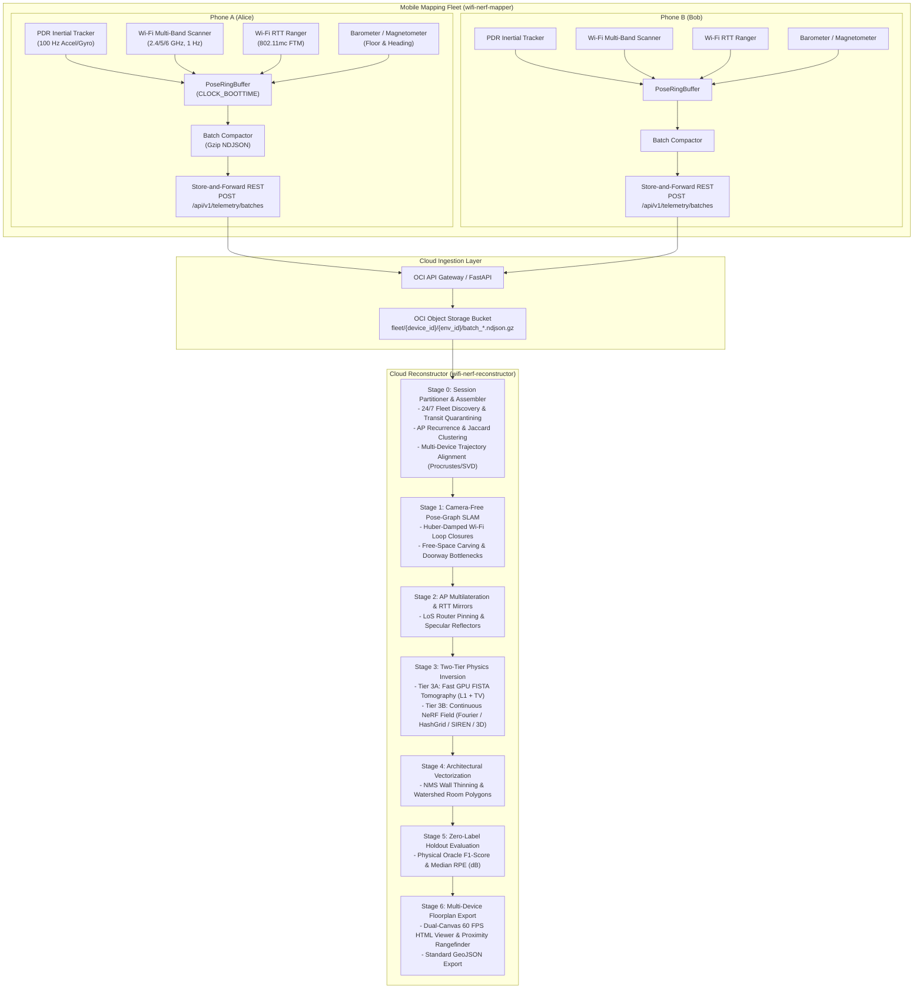
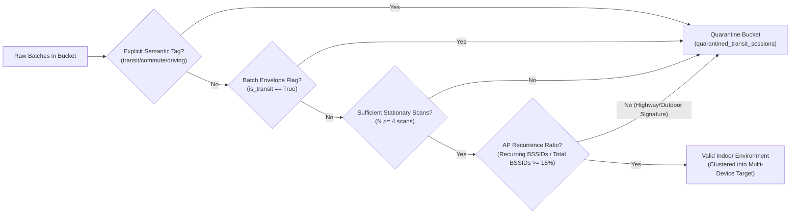

# Wi-Fi NeRF Floorplan Reconstructor (`wifi-nerf-reconstructor`)
> **Focus: Multi-Device Fleet Partitioning, OCI Object Storage Integration, Zero-Label Physics Inversion & Collaborative Floorplan Reconstruction**

`wifi-nerf-reconstructor` is the cloud reconstruction and mapping engine companion to [`wifi-nerf-mapper`](https://github.com/sky-45/wifi-nerf-mapper). It ingests streaming compressed `.ndjson.gz` telemetry batches directly from **Oracle Cloud Infrastructure (OCI) Object Storage** (or AWS S3 / Local directories), clusters multi-device walks by physical environment, filters out transit sessions, and reconstructs unified architectural floorplans (CAD walls, doorways, rooms, and router pins) **without requiring cameras, lidar, ARCore, or ground-truth blueprints**.

---

## Architecture: End-to-End System Integration

The complete system operates as a decoupled, asynchronous pipeline between the mobile background collection agent (`wifi-nerf-mapper`) and the cloud reconstruction engine (`wifi-nerf-reconstructor`):



---

## OCI Object Storage Bucket Partition Hierarchy

Telemetry data is organized within the bucket using an immutable, query-optimized prefix partitioning scheme that segregates fleet hardware while enabling cross-device environmental clustering:

```
oci://<bucket-name>@<tenancy-namespace>/
└── fleet/
    ├── <device_id>/
    │   ├── <environment_id>/
    │   │   ├── batch_<timestamp_ns>_<seq_num>.ndjson.gz
    │   │   ├── batch_<timestamp_ns>_<seq_num>.ndjson.gz
    │   │   └── ...
    │   └── transit_<timestamp_ns>/
    │       └── batch_<timestamp_ns>_<seq_num>.ndjson.gz
    └── <device_id_2>/
        └── <environment_id>/
            └── batch_<timestamp_ns>_<seq_num>.ndjson.gz
```

### Partition Key Definitions
| Partition Element | Description | Example |
| :--- | :--- | :--- |
| `fleet/` | Root prefix segregating background mobile telemetry from model weights and exports. | `fleet/` |
| `{device_id}` | Unique hardware device identifier (hashed Android ID or UUID). | `device_pixel8_a194c` |
| `{env_id}` | Physical space identifier assigned by on-device RF clustering or cloud classification. | `residence_oak_42` |
| `batch_*.ndjson.gz` | Gzip-compressed micro-batch containing 20–50 synchronized sensor events. | `batch_1700100030400000000_0001.ndjson.gz` |

---

## 24/7 Environment Discovery & Transit Filtering

When phones run `wifi-nerf-mapper` in the background 24/7, devices move through three operational regimes:
1. **Stationary Dwell:** Device is resting on a desk or nightstand.
2. **Indoor Exploration:** User walks through their home or office (the target mapping regime).
3. **Transit Commute:** User is driving, riding a bus/subway, or walking outdoors on a sidewalk.

### Transit Quarantining Pipeline (`reconstructor/session_partitioner.py`)
Mapping transit data corrupts indoor floorplans with spurious free space and pseudo-walls. The `SessionPartitioner` automatically detects and quarantines transit batches before reconstruction through a two-stage filter:



#### Physical Heuristics
- **AP Recurrence Ratio:** In an indoor space, infrastructure APs are repeatedly visible across scans ($\ge 2$ times). In transit, the phone rapidly passes Wi-Fi routers at high speed, causing $>85\%$ of APs to be observed only once.
- **Linear Displacement vs. Dwell:** Paths with high velocity ($>2.5\text{ m/s}$) and open, non-revisiting topologies are quarantined.

---

## Multi-Device Collaborative Floorplan Merging

In real homes and commercial offices, no single person walks every room in a single session. Device A (Alice) may walk the living room and kitchen, while Device B (Bob) walks the bedrooms and hallway.

### 2D SE(2) Rigid Alignment via Shared AP Landmarks (`MultiDeviceAligner`)
Because each device records inertial PDR odometry in its own local coordinate frame $(x_0=0, y_0=0, \theta_0=0)$, the reconstructor aligns disparate walks into a unified coordinate frame using Line-of-Sight Wi-Fi Access Points as fixed physical anchors:

1. **AP Estimation per Device:** For each contributing device $d \in \{A, B\}$, Line-of-Sight multilateration estimates the coordinates of visible APs $P^{(d)}_k = (x^{(d)}_k, y^{(d)}_k)$ for shared AP groups $k \in \mathcal{K}_{\text{shared}}$.
2. **Optimal 2D Procrustes Alignment:** For two or more shared AP anchors, the reconstructor computes the optimal rigid rotation angle $\theta^*$ and translation vector $\mathbf{t}^* = (dx, dy)$ minimizing the anchor displacement:
   $$\min_{R \in \mathrm{SO}(2),\, \mathbf{t} \in \mathbb{R}^2} \sum_{k \in \mathcal{K}_{\text{shared}}} \left\| P^{(A)}_k - \left( R(\theta) P^{(B)}_k + \mathbf{t} \right) \right\|^2$$
   Solved in closed form via Singular Value Decomposition (SVD):
   $$H = \sum_{k} \left( P^{(B)}_k - \bar{P}^{(B)} \right) \left( P^{(A)}_k - \bar{P}^{(A)} \right)^T = U \Sigma V^T \implies R^* = V U^T, \quad \mathbf{t}^* = \bar{P}^{(A)} - R^* \bar{P}^{(B)}$$
3. **Trajectory Transformation & Fusion:** All poses, scans, and rays from secondary devices are transformed into the primary reference frame, producing a consolidated, multi-device dataset for joint pose-graph optimization and NeRF inversion.

---

## Complete NDJSON Event Schemas

Each `.ndjson.gz` batch file contains newline-delimited JSON objects with hardware-synchronized microsecond timestamps (`timestamp_ns` from Android `SystemClock.elapsedRealtimeNanos()` and `CLOCK_BOOTTIME`).

### 1. Batch Envelope (`batch_envelope`)
```json
{
  "event_type": "batch_envelope",
  "device_id": "device_pixel8_a194c",
  "environment_id": "residence_oak_42",
  "session_id": "session_550e8400-e29b-41d4",
  "batch_seq": 1,
  "timestamp_ns": 1700100030400000000,
  "start_time_ns": 1700100000000000000,
  "end_time_ns": 1700100030400000000,
  "event_count": 35,
  "is_transit": false,
  "battery_pct": 94,
  "battery_current_ua": -76400,
  "step_count_delta": 42
}
```

### 2. Wi-Fi Multi-Band Scan (`wifi_scan_batch`)
```json
{
  "event_type": "wifi_scan_batch",
  "timestamp_ns": 1700100030500000000,
  "pose": {
    "x": 3.421, "y": 2.185, "z": 0.0,
    "qx": 0.0, "qy": 0.0, "qz": 0.382, "qw": 0.924,
    "confidence": 0.95
  },
  "scans": [
    {
      "bssid": "a4:97:b1:11:22:10",
      "ssid": "HomeNet_2G",
      "ap_group_id": "a4:97:b1:11:22:xx",
      "band": "2.4GHz",
      "freq_mhz": 2437,
      "bw_mhz": 20,
      "rssi_dbm": -48,
      "is_80211mc": false,
      "hw_timestamp_ns": 1700100030490000000,
      "scan_age_ms": 10
    },
    {
      "bssid": "a4:97:b1:11:22:15",
      "ssid": "HomeNet_5G",
      "ap_group_id": "a4:97:b1:11:22:xx",
      "band": "5GHz",
      "freq_mhz": 5180,
      "bw_mhz": 80,
      "rssi_dbm": -61,
      "is_80211mc": true,
      "hw_timestamp_ns": 1700100030495000000,
      "scan_age_ms": 5
    }
  ],
  "multiband_pairs": [
    {
      "ap_group_id": "a4:97:b1:11:22:xx",
      "rssi_24_dbm": -48,
      "rssi_5_dbm": -61,
      "excess_wall_loss_db": 6.44
    }
  ]
}
```

### 3. Wi-Fi RTT Round-Trip Time (`wifi_rtt`)
```json
{
  "event_type": "wifi_rtt",
  "timestamp_ns": 1700100030510000000,
  "bssid": "a4:97:b1:11:22:15",
  "mode": "TWO_SIDED_80211MC",
  "distance_mm": 4820,
  "std_dev_mm": 120,
  "rssi_dbm": -61,
  "attempted": 8,
  "successful": 8,
  "pose": { "x": 3.421, "y": 2.185, "z": 0.0, "confidence": 0.95 }
}
```

### 4. Inertial & Atmospheric PDR (`mag_baro_pdr`)
```json
{
  "event_type": "mag_baro_pdr",
  "timestamp_ns": 1700100030550000000,
  "mag_norm_ut": 47.8,
  "pressure_hpa": 1012.35,
  "step_detected": true,
  "stride_length_m": 0.68,
  "is_stationary": false,
  "pose": { "x": 3.421, "y": 2.185, "z": 0.0, "confidence": 0.95 }
}
```

---

## Zero-Label Evaluation Methodology

Evaluating reconstructed indoor floorplans traditionally requires manual CAD blueprints or ground-truth laser scans. `wifi-nerf-reconstructor` implements a **physics-derived Zero-Label Evaluation Suite (`reconstructor/unlabeled_evaluator.py`)** that rigorously tests geometric accuracy without requiring ground truth:

### 1. Spatial Block Holdout Split
20% of the spatial trajectory blocks are held out during Stages 1–4. The remaining 80% is used for reconstruction. All metrics are computed strictly on the held-out validation set.

### 2. Multi-Band Physical Ground-Truth Oracle
High-frequency RF signals (5 GHz / 6 GHz) suffer severe attenuation through drywall and concrete ($\Delta \approx 6\text{ to }12\text{ dB}$ per interior partition), whereas low-frequency signals (2.4 GHz) pass through with minimal loss ($\Delta \approx 2\text{ dB}$).
The differential excess loss across bands serves as an unambiguous physical indicator of wall crossings:
$$\Delta L_{\text{excess}} = \left( \text{RSSI}_{2.4\text{GHz}} - \text{RSSI}_{5\text{GHz}} \right) - 20 \log_{10}\left( \frac{f_{5\text{GHz}}}{f_{2.4\text{GHz}}} \right)$$

- **Physical Wall Ground Truth ($Y_{\text{true}} = 1$):** $\Delta L_{\text{excess}} \ge 4.0\text{ dB}$.
- **Reconstructed Wall Prediction ($\hat{Y} = 1$):** Ray from AP to device intersects any vectorized CAD wall segment.

### 3. Metric Formulations
| Metric | Formula | Target |
| :--- | :--- | :--- |
| **Wall-Ray Precision** | $\frac{\text{True Positives}}{\text{True Positives} + \text{False Positives}}$ | $\ge 75\%$ |
| **Wall-Ray Recall** | $\frac{\text{True Positives}}{\text{True Positives} + \text{False Negatives}}$ | $\ge 75\%$ |
| **Wall-Ray F1-Score** | $2 \cdot \frac{\text{Precision} \cdot \text{Recall}}{\text{Precision} + \text{Recall}}$ | $\ge 75\%$ |
| **Median RPE (dB)** | $\text{median}\left(\left\| \text{RSSI}_{\text{obs}} - \text{RSSI}_{\text{pred}} \right\|\right)$ | $\le 4.5\text{ dB}$ |
| **Free-Space Collision Rate** | $\frac{\text{Wall Pixels inside Free-Space Mask}}{\text{Total Wall Pixels}}$ | $\le 5.0\%$ |

---

## Quick Start & CLI Usage

### 1. Run Complete Test Suite
```bash
python3 -m unittest discover -s tests -v
```

### 2. Scan Storage & Inspect Discovered Partitions
Scans an OCI bucket or local directory, discovers multi-device environments, and displays transit quarantine statistics:
```bash
python3 -m reconstructor.pipeline \
  --list-partitions \
  --blob-uri ./blob_store
```

### 3. Run End-to-End Multi-Device Demo
Generates a multi-device fleet scenario (`device_alice` and `device_bob` walking separate wings of the same house, plus a quarantined commute), merges the walks, and reconstructs the floorplan:
```bash
python3 -m reconstructor.pipeline \
  --demo \
  --blob-uri ./blob_store \
  --output-dir ./output
```

### 4. Run Multi-Device Reconstruction on OCI Object Storage
```bash
python3 -m reconstructor.pipeline \
  --blob-uri "oci://my-telemetry-bucket@my-tenancy-namespace/fleet" \
  --env-id "residence_oak_42" \
  --output-dir ./output
```
Open `output/viewer_residence_oak_42.html` in any web browser to interact with the multi-device merged 2D and 2.5D floorplan!

---

## Environment Clustering & Multi-Walk Consensus

### Why Environments Fragment in Mobile Telemetry
The mobile collector hashes visible BSSIDs (`Hash(BSSIDs)`) to create `environment_id`. Due to Wi-Fi beacon jitter and intermittent neighbor router visibility, a phone walking between 2 rooms often produces multiple IDs (e.g. `env_71ad368b5034c609` and `env_79f11c4a701db8a1`).

### Unifying Fragmented Environments
The `SessionPartitioner` computes pairwise Jaccard similarity across visible APs and identifies core recurring routers (e.g., matching MAC prefix or primary home SSID). It clusters fragmented sessions into unified building footprints:

```bash
# List discovered physical residence clusters
python3 -m reconstructor.pipeline --blob-uri ./blob_store --list-clusters

# Reconstruct an entire unified cluster across multiple walks and devices
python3 -m reconstructor.pipeline \
  --env-id "cluster_env_79f11c4a701db8a1" \
  --blob-uri ./blob_store \
  --output-dir ./output
```

---

## Neural Mapping Architectures

`wifi-nerf-reconstructor` supports 4 continuous neural coordinate representations in `reconstructor/nerfmap_engine.py`:

| Model Flag | Name | Key Capability |
| :--- | :--- | :--- |
| `--model fourier` | Fourier Coordinate MLP | Standard positional encoding baseline; robust convergence across dense scans. |
| `--model hashgrid` | Instant-NGP Hash Grid | Multi-resolution spatial hash tables; 10x faster convergence and sharpest 90° corners. |
| `--model siren` | SIREN Implicit Network | Periodic sine wave activations; enforces exact Helmholtz continuous physics derivatives. |
| `--model nerf_3d` | Continuous 3D NeRF | Height-aware (x, y, z) field; disambiguates low furniture (tables, chairs) from full walls. |

Example reconstruction using Instant-NGP Hash Grids:
```bash
python3 -m reconstructor.pipeline \
  --env-id "cluster_env_79f11c4a701db8a1" \
  --blob-uri ./blob_store \
  --model hashgrid
```

---

## Automated GPU Hyperparameter Tuning

Run automated sweeps over Fourier bands, FISTA regularization, wall percentiles, and free-space carver radii using the zero-label validation suite:

```bash
# Run automated hyperparameter tuning on NVIDIA GPU
python3 reconstructor/tune_hyperparameters.py \
  --blob-uri ./blob_store \
  --environments env_79f11c4a701db8a1 env_71ad368b5034c609 \
  --device cuda:0

# Benchmark and rank all 4 neural architectures side-by-side
python3 reconstructor/tune_hyperparameters.py \
  --benchmark-models \
  --blob-uri ./blob_store \
  --device cuda:0
```

---

## Dual-Canvas High-Performance HTML Viewer

The interactive browser dashboard (`output/viewer_*.html`) uses a zero-lag **Dual-Canvas Architecture**:
1. **Static Canvas (`mapCanvasStatic`)**: Renders isometric grid, room polygons, CAD walls, and RF heatmap only on zoom/pan/resize.
2. **Dynamic Canvas (`mapCanvasDynamic`)**: Runs at 60 FPS rendering only foreground entities:
   - **Animated 3D Phone Tracker**: Displays interpolated phone position, orientation flashlight cone, and altitude drop tether.
   - **Dynamic Laser Rangefinder Rays**: Casts real-time dashed rays to the 4 nearest CAD walls within 3.0 meters with floating distance tags (e.g. `0.78m`).
   - **Proximity Clearance Halo**: 0.35m radial safety buffer color-coded green (`> 0.8m`), amber (`0.4 - 0.8m`), and red (`<= 0.35m`).
   - **Real-Time HUD**: Displays coordinates, nearest wall clearance, compass heading, and walking speed throttled to 16 Hz.
3. **Wall Certainty Filter Slider**:
   - Live range slider in sidebar (`≥ 35%` default): adjusts the minimum confidence threshold in real time to filter out phantom artifacts and speculative noise.
   - **Visual Wall Tiers**:
     - **― Solid Bold Cyan (≥ 70%)**: Confirmed structural wall supported by multiple high-angle cross-cutting rays.
     - **╌ Dashed Amber (40–69%)**: Probable drywall partition or interior barrier.
     - **··· Dotted Gray (< 40%)**: Speculative shadow or RF diffraction artifact.
4. **Interactive Wall Inspector Card**:
   - Hovering or clicking any wall displays an instant floating inspector card detailing:
     - Certainty Score (e.g. `88%`) & Classification Badge
     - Wall Length ($m$) and Attenuation ($\text{dB/m}$)
     - Material Classification (Drywall, Single/Double Gypsum, Brick/Concrete)
     - Intersecting Ray Count & Angular Diversity ($^\circ$)
5. **Survey Ray Coverage (Observability) Layer**:
   - Toggleable density map showing where the phone surveyed thoroughly (emerald/amber) vs unobserved blind spots (dark blue/black).
6. **Automated Output Cleanup**:
   - Automatically unlinks and replaces prior `.html`, `.geojson`, `.json`, and `.npy` artifacts for target sessions before generating fresh runs:
     ```bash
     python3 -m reconstructor.pipeline --env-id cluster_env_79f11c4a701db8a1 --clean
     # Or purge all previous output files:
     python3 -m reconstructor.pipeline --env-id cluster_env_79f11c4a701db8a1 --clean-all
     ```
